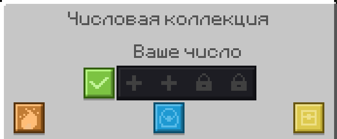

`/number` открывает меню цифр. Собирайте цифры от 0 до 9 и составьте число до 4 цифр, оно показывается у ника.

- Цифры выпадают из кейсов.
- Новые слоты открываются, если сдать нужные цифры.

## Кейсы за огонёк

| Серия | Награда |
| --- | --- |
| Каждые 5 дней | Обычный кейс |
| Каждые 25 дней | Кейс MAX |

Подробнее о серии на странице [Огоньки](/wiki/mekhaniki/ogonki).
