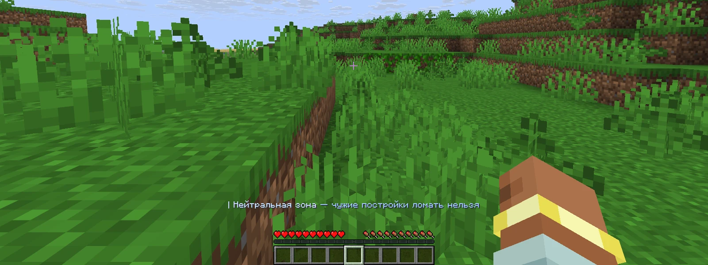

На сервере 4 фракции: Север, Юг, Восток и Запад. У каждой своя территория с аванпостом и деревней.

## Выбор фракции

- После первого входа на выбор стороны даётся 24 часа, потом игрока распределят сами.
- Численность фракций держится примерно равной.
- `/faction` открывает меню: состав, смена стороны, войны, ссылки на Discord фракции и сайт.
- Кнопка «Территория» показывает координаты земли, аванпоста и деревни, а компас начинает указывать на территорию.
- Значок фракции виден у ника в табе и в чате.

## Территории

| Зона | Правила |
| --- | --- |
| Своя территория | Подсказка над хотбаром при входе |
| Чужая территория | Подсказка над хотбаром при входе |
| Дикие земли | Подсказка над хотбаром при входе |
| Нейтральная зона у спавна | Убивать игроков нельзя, взрывы не ломают блоки |

> [!WARNING]
> Игроку с красным статусом закрыт вход в нейтральную зону. Если он всё же зайдёт, то погибнет, а вещи пропадут.

## Власть

| Что | Как устроено |
| --- | --- |
| Выборы президента, `/election` | Раз в 2 недели: 12 часов на заявки, потом 12 часов тайного голосования |
| Право голоса | После 3 дней во фракции |
| Заместитель | Один на фракцию, назначает президент |
| Война, `/war` | Начинается с ультиматума, на ответ 24 часа. Приняли: войны нет. Отклонили или промолчали: война |
| Союзники | Вступают в чужую войну с согласия той стороны, через 24 часа |

## Чат и Discord фракции

- `/fc` включает или выключает чат фракции, `/fc <текст>` отправляет одно сообщение. Совсем отключить чат можно в `/chatsettings`.
- У каждой фракции свой Discord-сервер. Роль «гражданин» выдаётся сама всем, кто привязал аккаунт и состоит во фракции.
