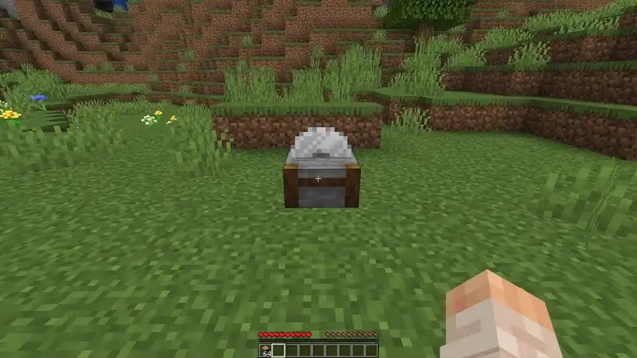

В камнерезе дерево превращается в доски и деревянные изделия. Работает для всех пород, включая бамбук.

## Дерево

| Из чего | Что получится |
| --- | --- |
| Бревно или древесина | 4 доски, 4 ступеньки, 8 плит, 2 забора, калитка, 2 двери, люк, 2 нажимные плиты, 4 кнопки, 2 таблички, 8 палок или бревно без коры |
| Доски | Ступенька, 2 плиты, кнопка или 2 палки |

## Камень и аметист

| Из чего | Что получится |
| --- | --- |
| Камень | Булыжник |
| Глубинный сланец | Колотый глубинный сланец |
| Аметистовая гроздь и бутоны | Бутоны поменьше |
