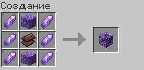
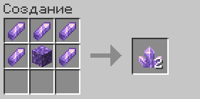
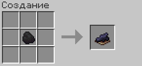
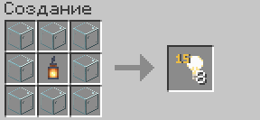
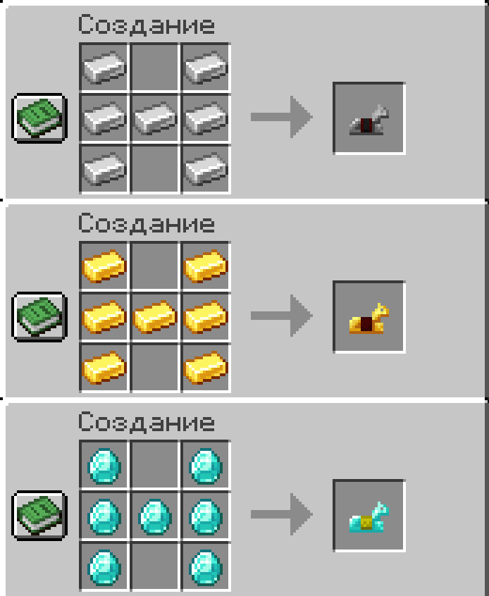

## Аметист

### Цветущий аметист

### Аметист

## Краситель и свет

### Чёрный краситель

### Блок света

## Конская броня

Железная, золотая и алмазная броня крафтятся той же формой, что и кожаная.

## Другие крафты

| Предмет | Рецепт |
| --- | --- |
| Светящийся чернильный мешок | Чернильный мешок и светящаяся пыль |
| Мембрана фантома | Перья и кость |
| Паутина, 2 шт. | 4 нити по углам и слизь в центре |
| Факельник | Факел в центре, вокруг одуванчики, снизу костная мука |
