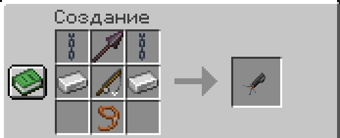
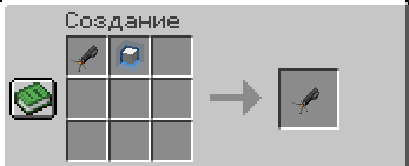

## Управление

| Действие | Что делает |
| --- | --- |
| ПКМ по блоку | Зацепиться и подтянуться |
| Shift + ЛКМ | Перезарядить |

> [!TIP]
> После полёта нет урона от падения.

## Крафт

Копьё и удочка подходят с любой прочностью.

## Улучшение

Крюк и банка энергии в верстаке дают бедный, редкий или эпический крюк. Улучшать можно и дальше: бедный до редкого или эпического, редкий до эпического.

| Крюк | Дальность | Перезарядка |
| --- | --- | --- |
| Обычный | 20 блоков | 60 с |
| Бедный | 40 блоков | 45 с |
| Редкий | 70 блоков | 35 с |
| Эпический | 125 блоков | 25 с |
