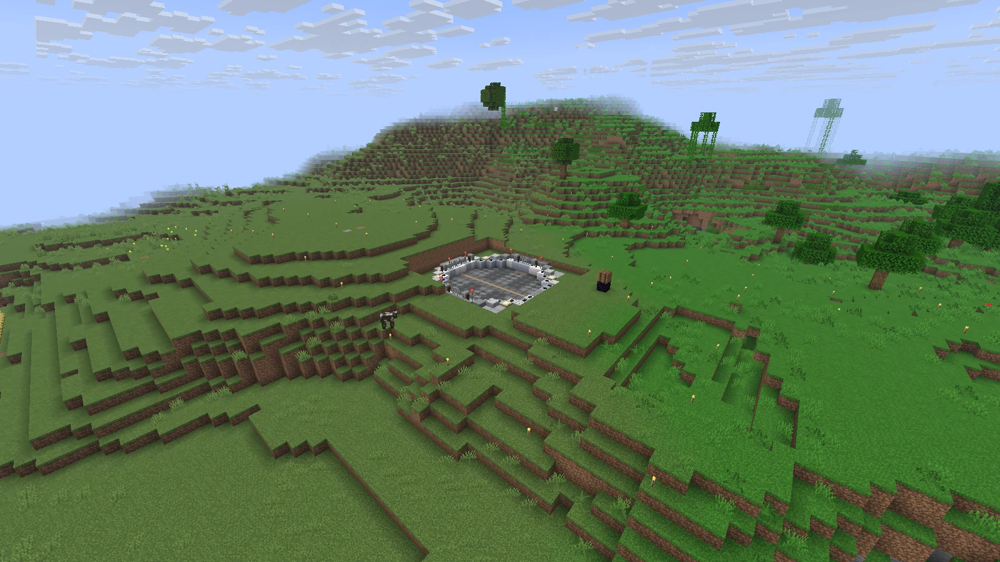

| Параметр | Значение |
| --- | --- |
| Сложность | Высокая |
| Граница мира | 2600 × 2600 блоков |
| Нейтральная зона у спавна | 150 × 150 блоков |
| Пропуск ночи | Достаточно, чтобы спали 30% игроков |
| Фантомы | Отключены |
| Энд | Закрыт до открытия |

## Нейтральная зона

При входе появляется подсказка. Чужие постройки ломать нельзя, убивать игроков нельзя, взрывы не ломают блоки.

> [!NOTE]
> Пока Энд закрыт, око Эндера в рамку портала не вставляется.

## Ванильные механики

Редстоун, нотные блоки и столкновения мобов работают как в ванилле: дюп ТНТ, буры и фермы работают.

Миникарты работают в честном режиме, без пещер и радара сущностей.
