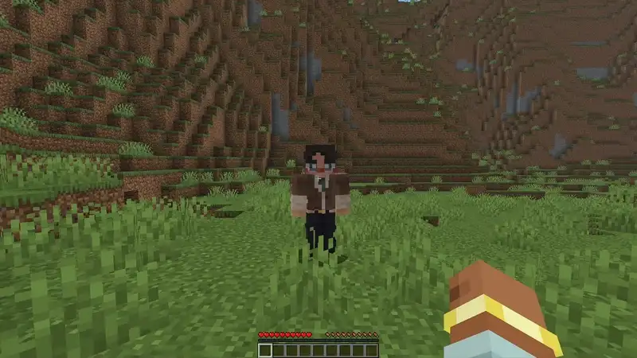

ПКМ по игроку пожимает ему руку. В чате и над хотбаром появится его ник и описание, которое он поставил.

Поставить своё описание: `/description set <описание>`.

> [!NOTE]
> Партнёру по браку вы не пожмёте руку, а шлёпнете.
