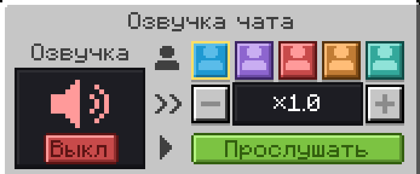

Ваши сообщения в чате звучат голосом рядом с вами. Их слышат игроки и с Plasmo Voice, и с Simple Voice Chat.

| Подписка | Что доступно |
| --- | --- |
| LITE | Стандартный голос |
| HIGH | 5 голосов на выбор и скорость |

| Ограничение | Значение |
| --- | --- |
| Радиус | 16 блоков |
| Длина сообщения | До 200 символов |
| Частота | Не чаще раза в 3 секунды |

- Включается в `/voice`, по умолчанию выключена. Там же кнопка «Прослушать».
- Громкость: ползунок «Озвучка чата» в Plasmo Voice или «Озвучка» в Simple Voice Chat.
