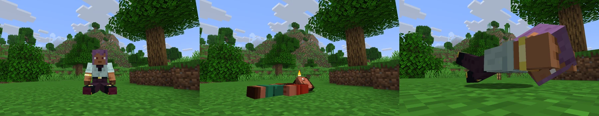

| Команда | Поза |
| --- | --- |
| `/sit` | Сесть |
| `/lay` | Лечь |
| `/crawl` | Ползти, или дважды присесть |
| `/spin` | Крутиться |
| `/bellyflop` | Лечь на живот |

Сесть на ступеньку или плиту можно ПКМ по ней.

