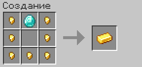
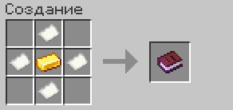

Игроки могут жениться и выходить замуж.

## Свадьба

1. Возьмите обручальные кольца и нажмите ПКМ по игроку.
2. Рядом должен быть свидетель.
3. О свадьбе узнаёт весь сервер, под объявлением появляется кнопка «Горько!».

> [!NOTE]
> Для предложения нужно минимум 3 часа наигранного времени.

## Команды

| Команда | Что делает |
| --- | --- |
| `/marry` | Статус брака, общая фамилия, домашнее имя для партнёра, свидетельство |
| `/kiss`, `/hug`, `/dance`, `/handhold` | Эмоции с партнёром |
| `/marry divorce` | Развод |

## Развод

ПКМ по партнёру документом о расторжении брака или `/marry divorce`.

> [!WARNING]
> Чем больше разводов, тем дольше нельзя снова вступить в брак.

## Крафты

### Обручальное кольцо

### Документ о расторжении брака

