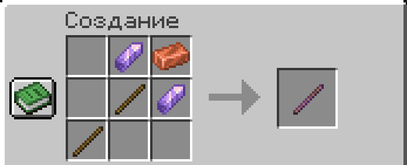

Палочка поворачивает блоки и меняет их форму.

| Действие | Что делает |
| --- | --- |
| ПКМ | Следующее значение |
| Shift + колесо | Значения вперёд и назад |
| ЛКМ | Другое свойство |

> [!NOTE]
> Работает только со своими блоками.

## Крафт

