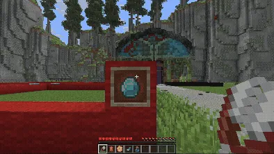

Все действия делаются Shift + ПКМ предметом по рамке.

| Предмет | Что делает |
| --- | --- |
| Ножницы | Сделать рамку невидимой или разблокировать |
| Кожа | Вернуть видимость |
| Пчелиные соты | Заблокировать рамку |
| Светящийся чернильный мешок | Включить свечение |
| Пузырёк с водой | Убрать свечение |

