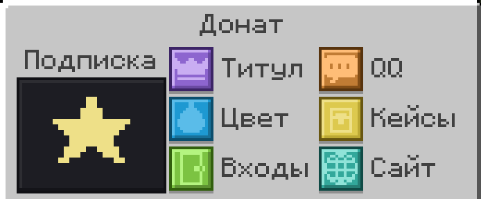

Донат открывает косметику и удобства, на силу в игре он не влияет. Купить можно на [shop.wireon.pro](https://shop.wireon.pro) картой или через СБП. Покупка приходит на сервер сама, даже если вы не в игре. Всё настраивается в `/donate`.

## Подписки

| Возможность | LITE | HIGH |
| --- | --- | --- |
| Титул в чате | Да | Да |
| Цвет ника | 7 цветов | 7 цветов и 3 градиента |
| Переливающийся ник в табе | Нет | Да |
| Сообщения входа и выхода | Из готовых | Свои, плюс сообщение смерти |
| Своё приветствие QQ | Нет | Да |
| Озвучка чата `/voice` | Стандартный голос | 5 голосов и скорость |
| Цвет текста в чате | Нет | Да, в том числе свой HEX |
| Свои пластинки `/disc` | Нет | Да |
| АФК-статус, `/hat`, `/sign` | Да | Да |
| `@here` | Раз в час | Раз в 10 минут |
| Кейс сразу и каждые 14 дней | Обычный | MAX |

> [!NOTE]
> Повторная покупка продлевает срок. Когда подписка заканчивается, донатные настройки сбрасываются сами.

## Спонсор

Уровень копится по сумме всех покупок и остаётся навсегда.

| Уровень | Сумма | Что даёт |
| --- | --- | --- |
| Спонсор 1 | 3000 ₽ | Пластинки, цвет ника, сообщения из готовых |
| Спонсор 2 | 5000 ₽ | Всё из LITE |
| Спонсор 3 | 10000 ₽ | Всё из HIGH |
| Спонсор 4 | 15000 ₽ | Всё из Спонсора 3 и оповещение всем при вашем входе |

## Кейсы

| Кейс | Что выпадает |
| --- | --- |
| Обычный | Случайная цифра для числа у ника, см. `/number` |
| MAX | Цифра всегда, иногда две |
| Шапок | Одна из 11 шапок: обычные, редкие и анимированные |

- Открыть кейсы: `/donate` → «Кейсы». Надеть шапку: `/donate` → «Шапки».
- Если собраны все шапки, кейс шапок не тратится.
- Наборы по 5 кейсов выходят дешевле.

## Подарок

В корзине отметьте «В подарок» и укажите свой ник. Покупка придёт другу, а сумма засчитается в ваше спонсорство.

## Услуги

| Услуга | Что делает |
| --- | --- |
| Размут | Снимает текущий мут |
| Разбан | Снимает текущий бан |

> [!WARNING]
> Разбан не действует на баны за читы и мошенничество.
